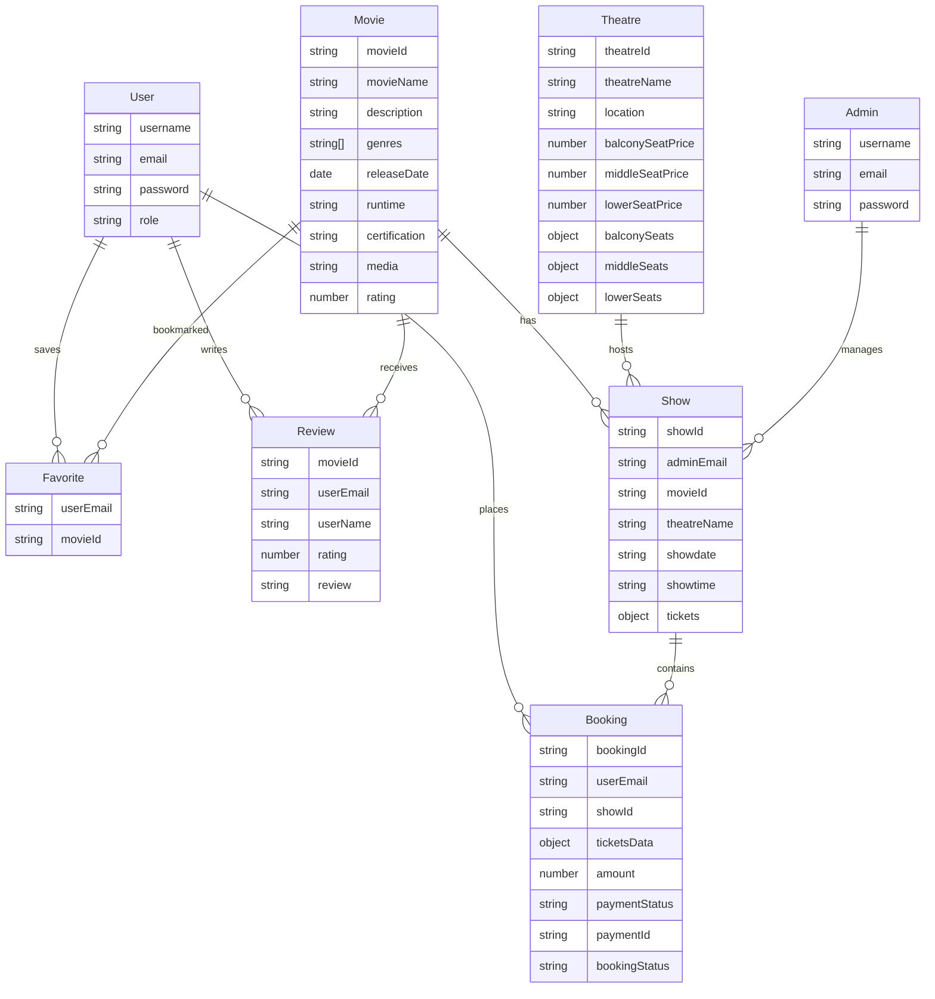

# iMovies — Complete MERN Stack Cinema Ticket Booking System

A production-ready, full-stack **Movie Ticket Booking Web Application** built according to the **MySkillWallet** project specifications, ER diagrams, MVC architecture, and user workflows.

---

## 🎬 Project Overview

iMovies enables cinema enthusiasts to browse current and upcoming film releases, explore multi-tier theatre layouts, view real-time seat availability, select and reserve seats with concurrency protection, simulate payments, generate digital E-Tickets, submit movie reviews, and manage booking history. The platform also provides a password-protected Administrator Dashboard for real-time monitoring of revenue, movies, theatres, screenings, and bookings.

---

## 🛠 Technology Stack

### Frontend
- **React 18** & **Vite**: Ultra-fast single-page application framework
- **React Router v6**: Client-side routing, protected user routes, and admin guard middleware
- **Axios**: Centralized REST API service with JWT authorization interceptors
- **Bootstrap 5 & React Bootstrap**: Responsive cinema UI components
- **React Icons**: Modern vector icon set
- **Custom Dark Theme CSS**: Immersive cinema styling with glowing cards, visual theatre screen curve, and ticket stub styling

### Backend
- **Node.js (v24)** & **Express.js (v4)**: Modular RESTful API
- **MongoDB (v9.0)** & **Mongoose (v8.9)**: Schemas, validations, virtuals, and indexes
- **JWT (JSON Web Tokens)**: Secure token-based authentication
- **bcryptjs**: Password hashing (10 salt rounds)
- **node-cron**: Scheduled background jobs for email reminders and stale booking cleanup
- **nodemailer**: Email notification dispatcher with fallback simulator

---

## 🏗 Architecture & Folder Structure

```text
iMovies/
├── backend/
│   ├── config/
│   ├── controllers/
│   │   ├── adminController.js      # Admin authentication & analytics
│   │   ├── authController.js       # User register, login & profile
│   │   ├── bookingController.js    # Concurrency-safe seat reservation & cancellation
│   │   ├── favoriteController.js   # User watchlist management
│   │   ├── movieController.js      # Movie CRUD & search/filter
│   │   ├── reviewController.js     # User ratings & reviews
│   │   ├── showController.js       # Screening schedules & conflict checks
│   │   └── theatreController.js    # Multi-tier theatre screens
│   ├── middlewares/
│   │   └── fetchUser.js            # JWT verification & role authorization (requireAdmin)
│   ├── models/
│   │   ├── adminModel.js           # Admin schema (username, email, password)
│   │   ├── bookingModel.js         # Booking schema (bookingId, userEmail, showId, ticketsData)
│   │   ├── favoriteModel.js        # Favorite schema (userEmail, movieId)
│   │   ├── movieModel.js           # Movie schema (movieName, description, genres, releaseDate, runtime, certification, media)
│   │   ├── reviewModel.js          # Review schema (movieId, userEmail, userName, rating, review)
│   │   ├── showModel.js            # Show schema (adminEmail, showId, movieId, theatreName, showdate, showtime, tickets)
│   │   ├── theatreModel.js         # Theatre schema (theatreName, theatreId, location, balcony/middle/lower pricing & seats)
│   │   └── userModel.js            # User schema (username, email, password, role)
│   ├── routes/
│   │   ├── adminRoutes.js
│   │   ├── authRoutes.js
│   │   ├── bookingRoutes.js
│   │   ├── favoriteRoutes.js
│   │   ├── movieRoutes.js
│   │   ├── notificationRoutes.js
│   │   ├── reviewRoutes.js
│   │   ├── showRoutes.js
│   │   └── theatreRoutes.js
│   ├── utils/
│   │   ├── cleanupService.js       # Automated stale reservation cleanup
│   │   ├── mailer.js               # Email notification service
│   │   ├── reminderService.js      # Same-day show reminder service
│   │   ├── seedData.js             # Initial database seed script
│   │   └── testApi.js              # 20-point backend automated test suite
│   ├── server.js                   # Express application entrypoint
│   ├── package.json
│   ├── .env
│   └── .env.example
├── frontend/
│   ├── public/
│   ├── src/
│   │   ├── components/
│   │   │   ├── Header.jsx          # Navbar with notifications & user profile
│   │   │   ├── Footer.jsx          # Cinema footer & technology credits
│   │   │   ├── MovieCard.jsx       # Poster card with ratings & watchlist toggle
│   │   │   ├── SearchAndFilter.jsx # Live title search & genre filtering pills
│   │   │   ├── LoadingIndicator.jsx
│   │   │   └── ErrorMessage.jsx
│   │   ├── context/
│   │   │   └── AuthContext.jsx     # Shared authentication state & localStorage persistence
│   │   ├── pages/
│   │   │   ├── HomePage.jsx        # Hero banner, catalog & filters
│   │   │   ├── LoginPage.jsx       # User & Admin dual login with demo quick-fill
│   │   │   ├── RegisterPage.jsx    # User registration with validation
│   │   │   ├── MovieDetailsPage.jsx# Movie info, trailer banner, showtimes & reviews
│   │   │   ├── ShowsPage.jsx       # All show listings with movie & theatre filters
│   │   │   ├── SeatSelectionPage.jsx # Interactive 3-tier seat grid with live pricing
│   │   │   ├── BookingConfirmationPage.jsx # Digital E-ticket & print receipt
│   │   │   ├── BookingHistoryPage.jsx # Past & active bookings with cancellation
│   │   │   ├── FavoritesPage.jsx   # Personal movie watchlist
│   │   │   ├── ProfilePage.jsx     # User details & quick portal links
│   │   │   ├── AdminDashboardPage.jsx # Revenue, bookings, and operations metrics
│   │   │   ├── AdminMoviesPage.jsx # Catalog CRUD operations
│   │   │   ├── AdminTheatresPage.jsx # Theatre screen management
│   │   │   ├── AdminShowsPage.jsx  # Show screening scheduler
│   │   │   └── AdminBookingsPage.jsx # All customer reservations & revenue audit
│   │   ├── services/
│   │   │   └── api.js              # Central Axios client
│   │   ├── App.jsx
│   │   ├── App.css
│   │   ├── index.css
│   │   └── main.jsx
│   ├── index.html
│   ├── vite.config.js
│   ├── package.json
│   ├── .env
│   └── .env.example
└── README.md
```

---

## 🚀 Quick Start Instructions

### 1. Prerequisites
- **Node.js**: v18 or higher (v24 installed)
- **MongoDB**: Local MongoDB instance running on `mongodb://127.0.0.1:27017`

### 2. Backend Setup & Startup
```bash
cd backend
npm install
node utils/seedData.js   # Seeds movies, theatres, shows, and admin/user accounts
node server.js           # Starts server on http://localhost:3000
```

### 3. Frontend Setup & Startup
```bash
cd frontend
npm install
npm run dev              # Starts Vite on http://localhost:5173
```

---

## 🔑 Demo Credentials

| Role | Email | Password |
|---|---|---|
| **Administrator** | `admin@imovies.com` | `Admin@12345` |
| **Test User** | `user@imovies.com` | `User@12345` |

*(A convenient one-click "Demo User" and "Demo Admin" autofill button is available on the Login page).*

---

## 🔒 Seat Concurrency & Concurrency Protection

To guarantee that two users can never book the same seat for the same show:
1. Seat selection on the frontend is cross-checked against backend state.
2. In `POST /api/bookings`, the server checks every seat ID (`show.tickets[seatId].isBooked`).
3. If any seat is already booked, the server immediately rejects the request with HTTP **409 Conflict** and returns `{ error: "Seats [X] are no longer available" }`.
4. The seat assignment and booking record creation are performed synchronously with Mongoose atomic updates.
5. If a booking is cancelled by a user or administrator, the reserved seats are safely released back to the show.

---

## 🧪 Automated Test Suite

A built-in 20-point comprehensive automated test suite validates the entire backend:

```bash
cd backend
npm test
```

### Verified Test Results:
```text
==========================================
   iMovies Backend Comprehensive Tests    
==========================================

✅ PASS: 1. Health check endpoint responds OK
✅ PASS: 2. User registration succeeds
✅ PASS: 3. Duplicate registration is rejected
✅ PASS: 4. Valid login succeeds and returns JWT
✅ PASS: 5. Invalid credentials rejected
✅ PASS: 6. Protected route without token rejected (401)
✅ PASS: 7. Protected route with token succeeds
✅ PASS: 8. Admin login succeeds
✅ PASS: 9. Ordinary user blocked from admin routes (403)
✅ PASS: 10. Admin stats dashboard loads
✅ PASS: 11. Movie listings retrieved
✅ PASS: 12. Theatre listings retrieved
✅ PASS: 13. Shows retrieved
✅ PASS: 14. Seat booking persists successfully
✅ PASS: 15. Duplicate seat reservation rejected (409 Conflict)
✅ PASS: 16. User booking history restricted strictly to user's own bookings
✅ PASS: 17. Add favorite movie succeeds
✅ PASS: 18. User favorites list retrieved
✅ PASS: 19. Submit movie review succeeds
✅ PASS: 20. In-app notifications generated

==========================================
Test Results: 20 PASSED, 0 FAILED
==========================================
```

---

## 🌐 API Reference

| Endpoint | Method | Access | Description |
|---|---|---|---|
| `/api/health` | GET | Public | Server health status |
| `/api/auth/register` | POST | Public | User registration |
| `/api/auth/login` | POST | Public | User login |
| `/api/auth/me` | GET | User | Current logged-in user profile |
| `/api/auth/admin/login` | POST | Public | Admin login |
| `/api/auth/admin/stats` | GET | Admin | System analytics & revenue summary |
| `/api/auth/admin/bookings` | GET | Admin | All system bookings |
| `/api/movie` | GET | Public | List movies (filters: search, genre) |
| `/api/movie/:id` | GET | Public | Single movie details |
| `/api/movie` | POST | Admin | Add new movie |
| `/api/movie/:id` | DELETE | Admin | Delete movie |
| `/api/theatre` | GET | Public | List all theatres |
| `/api/theatre` | POST | Admin | Add new theatre |
| `/api/theatre/:id` | DELETE | Admin | Delete theatre |
| `/api/shows` | GET | Public | List shows (filters: movieId, theatreName) |
| `/api/shows/:id` | GET | Public | Show seat layout & availability |
| `/api/shows` | POST | Admin | Schedule show (conflict checked) |
| `/api/shows/:id` | DELETE | Admin | Delete show |
| `/api/bookings` | POST | User | Reserve seats & create booking |
| `/api/bookings` | GET | User | User's personal booking history |
| `/api/bookings/:id` | GET | User | Digital E-Ticket details |
| `/api/bookings/:id/cancel` | PUT | User/Admin | Cancel booking & release seats |
| `/api/favorite` | GET / POST | User | Manage user watchlist |
| `/api/favorite/:movieId` | DELETE | User | Remove from watchlist |
| `/api/review` | POST | User | Submit rating and review |
| `/api/review/:movieId` | GET | Public | Read reviews for movie |
| `/api/notifications` | GET | User | Live in-app booking notifications |

---

## 📜 ER Diagram & Schema Design

Based on the official MySkillWallet ER diagram:



---

## 📌 Submission Compliance & Preserved Data
- All 4 pre-existing movie records (*Interstellar*, *The Dark Knight*, *Avatar*, *Dune: Part Two*) are preserved with backward-compatible schema mappings.
- Existing database `imovies` maintained without destructive migrations.
- Tested on Windows environment with Node.js v24.22.1 and MongoDB v9.0.
